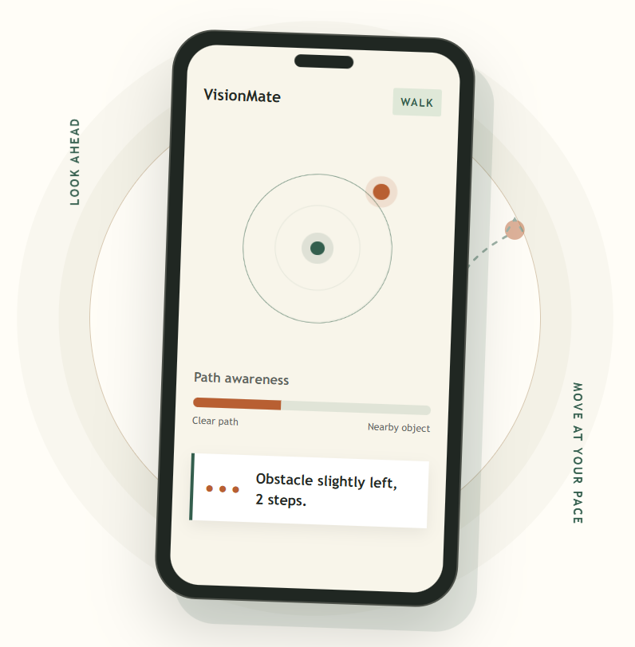
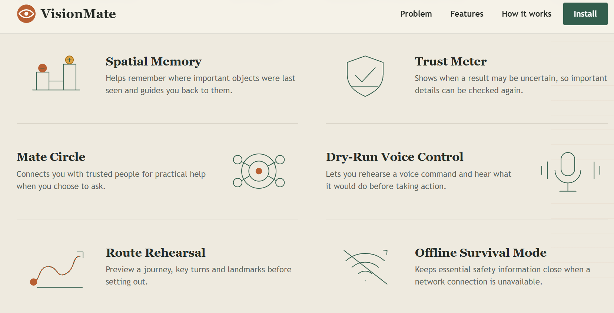
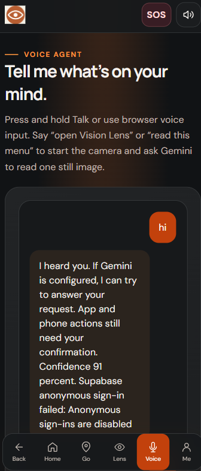
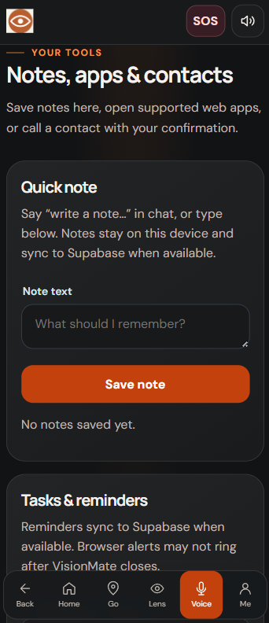
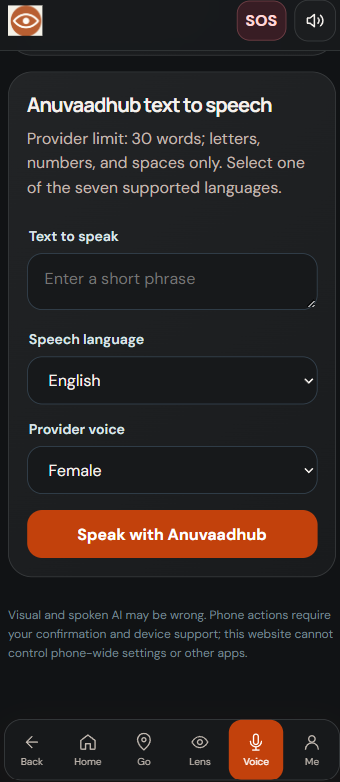
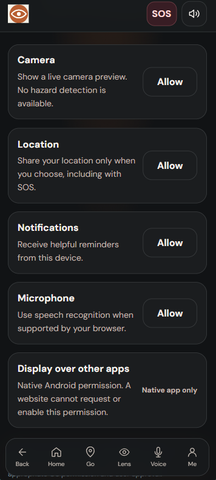

# VisionMate

VisionMate is an accessible AI-powered companion designed for blind and low-vision people. It helps users navigate daily life with voice-first interaction, camera-based assistance, translation, route information, reminders, and emergency support.

This repository contains the product showcase website for VisionMate, built as a simple static landing page to present the app clearly and accessibly.

## Project links

- **Live website:** [VisionMate — Your Accessible Assistant](https://visionmate-one.vercel.app/)
- **Product showcase:** [VisionMate product story](https://visionmate-product.vercel.app/)
- **GitHub repository:** [ZAHEER-R/visionmate](https://github.com/ZAHEER-R/visionmate)
- **Clone with Git:** `git clone https://github.com/ZAHEER-R/visionmate.git`
- **Android APK:** [Download VisionMateai.apk](./VisionMateai.apk) from the repository root.

<p align="center">
  
</p>

<p align="center">
  
</p>

## Why VisionMate

VisionMate gives users a more independent way to:

- understand what is in front of them
- read text from documents, signs, and labels
- ask questions by voice
- get route and location guidance
- translate between languages
- manage reminders and personal notes
- contact trusted people quickly in emergencies

The product is designed for people who want practical support without relying on sight alone.

## Key product features

- Press-and-hold Talk button for natural voice input
- Voice agent that responds in plain language
- Vision Lens for camera-based scene understanding and text reading
- Travel and location help with route information and mapping
- Translation for multilingual support
- Notes, reminders, and profile management
- Emergency support and trusted-contact access
- Large touch-friendly controls for mobile use

## How it works

1. The user presses and holds the Talk button and speaks.
2. VisionMate listens and interprets the request.
3. The app can use camera, location, translation, and assistant features depending on the task.
4. The result is spoken back clearly so the user can act confidently.
5. The user stays in control and confirms important actions.

## Product showcase gallery

These preview images are included in the project assets and can be used in the GitHub repository to visually present the app experience.

<p align="center">
  
</p>

<p align="center">
  
</p>

<p align="center">
  
</p>

<p align="center">
  
</p>

<p align="center">
  
</p>

<p align="center">
  
</p>

<p align="center">
  
</p>

<p align="center">
  
</p>

<p align="center">
  
</p>

<p align="center">
  
</p>

<p align="center">
  
</p>

## Project structure

```text
branding2/
├── index.html
├── style.css
├── script.js
├── README.md
├── LICENSE
├── VisionMateai.apk
├── assets.zip
├── assets/
│   ├── icon.svg
│   ├── logo.png
│   ├── preview1.png
│   ├── preview2.png
│   ├── preview3.png
│   ├── preview4.png
│   ├── preview5.png
│   ├── preview6.png
│   ├── preview7.png
│   ├── preview8.png
│   ├── preview9.png
│   ├── preview10.png
│   ├── preview11.png
│   └── icons/
└── sourcecode2.zip
```

## Run locally

Open the project folder and launch `index.html` directly in a browser.

You can also use VS Code Live Server or any local static web server.

```bash
python -m http.server 8000
```

Then open:

```text
http://localhost:8000
```

## Deployment

This is a static website and can be deployed easily on GitHub Pages, Netlify, Vercel, or any static hosting service.

### GitHub Pages

1. Push this repository to GitHub.
2. Open the repository settings.
3. Go to Pages.
4. Select the main branch and the root folder.
5. Save and wait for the site to publish.

## License

This project is licensed under the [MIT License](LICENSE).

## Contact

For product inquiries, support, or collaborations, use the contact information provided in the product website or connect through your organization’s preferred channels.

---

VisionMate helps people move through daily life with more confidence, clarity, and independence.
